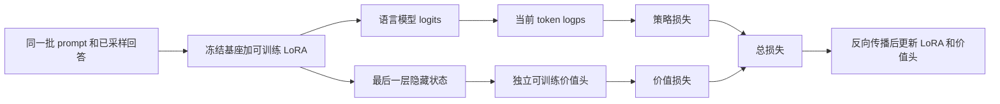

# PPO 在 qwen_math 中的实现流程

本文按当前项目代码梳理，适合一边阅读、一边通过 VS Code 的 F12 跳到对应函数。
重点是一次数学题回答如何变成奖励、优势、损失和参数更新，以及训练如何保存、恢复。
文中的代码块标为“摘录”或“示意”的，均不是另外一套需要复制运行的训练器。

当前可运行入口是 [scripts/train_ppo.py](../scripts/train_ppo.py)。
它与 [scripts/train.py](../scripts/train.py) 的旧配置检查入口分开；旧入口仍未接入实际算法训练。
部分源码文件顶部仍有“待实现”字样，应以函数体和这里说明的实际调用链为准。

## 1. PPO 在本项目中做什么

SFT 阶段给模型看“问题 + 标准解题过程”，提高标准回答 token 的概率。
PPO 阶段只给模型问题，让模型自己生成回答，再用数值答案是否正确来评分。
模型通过这些奖励调整回答概率，同时训练一个价值头，预测后续还能获得多少回报。

本项目是“数学规则奖励 + PPO”，没有另外训练一个神经网络奖励模型。

一次迭代的主线是：

```text
抽取训练题目
    ↓
策略模型生成回答
    ↓
解析数值答案，得到每条回答的 0/1 得分
    ↓
保存采样策略概率、固定参考模型概率、采样时的价值预测
    ↓
组合 KL 奖励和答案奖励
    ↓
计算 TD 误差、GAE、目标回报、标准化优势
    ↓
在固定的这批回答上执行若干次 PPO 参数更新
    ↓
记录日志，定期保存 checkpoint
```

“在线”指回答来自当前策略的现场采样，不是一直训练一份预先固定的模型回答文件。

## 2. 代码地图与实际调用顺序

### 2.1 文件职责

| 文件 | 主要职责 |
| --- | --- |
| [scripts/train_ppo.py](../scripts/train_ppo.py) | 读取配置、准备数据和模型、抽题、循环训练、日志、保存、恢复 |
| [models/loader.py](../src/qwen_math/models/loader.py) | 加载基座、SFT adapter、可训练策略、固定参考模型 |
| [models/value_head.py](../src/qwen_math/models/value_head.py) | 价值头，以及策略概率和价值的前向计算 |
| [data/io.py](../src/qwen_math/data/io.py) | 读取并校验原来的 SFT JSONL |
| [data/templates.py](../src/qwen_math/data/templates.py) | 统一问题模板 |
| [rollout/sampler.py](../src/qwen_math/rollout/sampler.py) | 单题生成、EOS 处理、构造 rollout、收集旧概率和参考概率 |
| [data/collators.py](../src/qwen_math/data/collators.py) | 右侧补齐并组成 batch |
| [rewards/math_reward.py](../src/qwen_math/rewards/math_reward.py) | 提取最终答案、数值归一化、计算正确性奖励 |
| [algorithms/ppo.py](../src/qwen_math/algorithms/ppo.py) | KL 奖励、TD、GAE、回报、优势标准化、PPO 损失 |
| [trainers/ppo.py](../src/qwen_math/trainers/ppo.py) | 串联一次采样与训练，执行反向传播和优化器更新 |
| [common/tensor_ops.py](../src/qwen_math/common/tensor_ops.py) | 因果位移、目标 token 对数概率、带 mask 的归约 |
| [common/checkpoint.py](../src/qwen_math/common/checkpoint.py) | adapter、日志、配置与哈希等共享工具 |

### 2.2 函数调用树

```text
main
├─ parse_args
└─ run_training
   ├─ validate_config / source_hashes / load_resume_state
   ├─ load_tokenizer / load_records
   ├─ load_ppo_policy / load_reference_model
   ├─ build_ppo_optimizer
   └─ 每次 iteration
      ├─ sampler.sample：随机抽题
      ├─ train_ppo_iteration
      │  ├─ sample_rollout_batch
      │  │  ├─ generate_response → encode_rollout_prompt → format_prompt
      │  │  ├─ build_rollout_sample → trim_response
      │  │  └─ collate_rollouts → collate_sft
      │  ├─ score_responses
      │  │  └─ answer_correctness
      │  │     ├─ extract_final_answer
      │  │     └─ normalize_numeric_answer
      │  ├─ prepare_rollout_batch
      │  │  ├─ collect_logps：策略与参考模型各一次
      │  │  ├─ rollout_values
      │  │  ├─ compute_kl_rewards / add_terminal_rewards
      │  │  └─ prepare_advantages
      │  │     ├─ compute_td_errors / compute_gae
      │  │     ├─ compute_returns
      │  │     └─ normalize_advantages
      │  └─ update_ppo
      │     └─ 重复 update_epochs 次：ppo_step
      │        ├─ optimizer.zero_grad
      │        ├─ ppo_backward
      │        │  ├─ forward_policy_value
      │        │  ├─ ppo_loss
      │        │  │  ├─ ppo_policy_loss → policy_ratio
      │        │  │  └─ ppo_value_loss
      │        │  └─ total_loss.backward
      │        ├─ clip_grad_norm_
      │        └─ optimizer.step
      └─ append_metrics / save_checkpoint
```

## 3. 先区分四个角色

| 角色 | 代码变量 | 用途 | 是否更新 |
| --- | --- | --- | --- |
| 当前策略 | `model` | 生成回答，计算更新时的 `new_logps` | 更新可训练 LoRA，冻结基座 |
| 采样旧策略记录 | `old_logps` | 记录生成这批回答时的概率，作为 PPO ratio 的分母 | 同一批数据更新期间不变 |
| 固定 SFT 参考模型 | `reference_model` | 计算 `ref_logps`，构造限制偏离 SFT 的 KL 奖励 | 全程冻结 |
| 价值头 | `value_head` | 从策略隐藏状态预测后续回报 | 与策略 LoRA 联合更新 |

当前并没有为“旧策略”额外复制第三份完整语言模型。采样后、第一次更新前，
使用仍未改变的策略重新前向，保存 `old_logps` 和 `old_values`，即可固定这批数据的比较基准。

两份完整语言模型是“当前策略”和“固定参考模型”。它们从同一个 SFT 快照初始化，
但分别加载，参数不共享。随着 PPO 更新，策略与参考模型逐渐产生差异。

PPO ratio 比较 **new 与 old**；KL 奖励比较 **old 与 ref**。不能交换这两组对象。

### 3.1 模型初始化

`load_ppo_policy`：

1. 加载 `Qwen/Qwen2.5-Math-1.5B` 或配置指定的本地基座。
2. 用 `load_adapter(..., is_trainable=True)` 恢复已有 SFT LoRA。
3. 使用 `model.eval()` 关闭 dropout，但不关闭自动求导。
4. 新建 `ValueHead(model.config.hidden_size)`，移动到同一设备，使用 FP32。

这里不再调用 `add_lora` 新建一个空 adapter。我们继续优化已经 SFT 过的 adapter。

`load_reference_model` 从同一个 SFT adapter 独立加载参考模型，执行：

```python
model.requires_grad_(False)
model.eval()
```

`eval()` 控制 dropout 等模块行为；`requires_grad_(False)` 才是冻结参数的设置。
采样和目标准备另外使用 `torch.no_grad()`，避免建立不需要的计算图。

### 3.2 价值头与共享骨干

```text
策略模型的最后一层隐藏状态 [B,T,H]
    ├─ 原语言模型输出头 → logits [B,T,V]
    └─ ValueHead：Linear(H,1) → [B,T,1] → squeeze(-1) → [B,T]
```

价值头预测的是回报，不是答案正确概率，没有使用 sigmoid，也不要求输出在 `[0,1]`。
因为回报还包含 KL 项，其数值范围也不限定在 `[0,1]`。

“共享骨干”表示价值头使用策略的隐藏状态，而非另建一个完整 critic 语言模型。
价值头虽是独立 Python 模块，价值损失仍会沿隐藏状态反传，更新策略中的可训练 LoRA。
冻结的基座参数不更新。

基座默认 BF16、价值头 FP32，所以前向中有：

```python
hidden = hidden.to(next(value_head.parameters()).dtype)
```

类型转换不等于 `detach()`，不会切断通向策略 LoRA 的梯度。

## 4. 训练数据如何进入 PPO

### 4.1 读取什么，使用什么

入口默认读取 `data/processed/sft_train.jsonl`，格式仍是：

```json
{"question": "What is 2+3?", "solution": "2+3=5.\nFinal answer: 5", "answer": "5"}
```

因为复用了 `load_sft_records`，文件中三个字段目前都必须是非空字符串。
但 `load_records` 返回给 PPO 的记录只保留：

```python
{"question": record["question"], "answer": record["answer"]}
```

`question` 进入模型；`answer` 只用于事后评分；`solution` 不参与 PPO 的生成或损失。
不能把标准答案或标准解题过程混入采样 prompt。

### 4.2 问题模板与长度

`format_prompt` 的格式为：

```text
Question:
What is 2+3?

Solution:
```

模板与 SFT 一致，不使用聊天模板，也不主动给 prompt 追加 EOS。

正常训练时，入口对完整格式化 prompt 分词：超过 `max_prompt_tokens` 的题目整条过滤，
不从中间裁掉数学条件。`max_new_tokens` 单独控制回答长度。
入口还检查两者上限之和不超过模型配置的最大上下文长度。

`--dry-run` 不加载 tokenizer，所以不会执行分词长度过滤；dry-run 的样本数量不一定
等于正式训练过滤后的样本数量，也不能证明 GPU 显存足够。

### 4.3 SFT 与 PPO 使用同一批题目是否合适

可以把它作为“在相同训练题目上进一步优化 SFT 策略”的实验。
两阶段的监督信号不同：SFT 模仿固定解答，PPO 评价策略自己生成的回答。
复用训练集本身不等于把测试集泄漏到训练中，但只看训练奖励无法区分记忆和泛化。

当前实现不读取验证集或测试集进行更新。原来的验证集继续用于调参；最终应在固定的
独立测试集上，用相同 prompt、解码设置、回答长度和答案解析方法比较 SFT 与 PPO。
若要研究“在 SFT 未见题目上做 RL”的效果，应提前划分不同训练子集，并重新建立对应的
SFT 起点；不能把一个已经参与 SFT 的题目事后改名为“未见 PPO 数据”。

## 5. 抽题、生成和构造 rollout

### 5.1 iteration、update 与 epoch

入口使用独立的 `random.Random(seed)`，每次执行：

```python
selected = sampler.sample(records, config["rollout_prompts"])
```

同一次抽题不重复；不同 iteration 之间可以重复，没有按 epoch 无放回遍历全部数据。
默认 `max_iterations=100`、`rollout_prompts=1` 表示抽取 100 题次，独立题目数可能少于 100。
每题当前生成一条回答，不是 GRPO 的同题分组多回答采样。

一次 iteration 包含一次采样和 `update_epochs` 次优化器更新。
因此当前日志中的 `updates = iteration * update_epochs`。
`update_epochs=2` 也不是把整个训练集训练两轮。

### 5.2 `encode_rollout_prompt`

用 tokenizer 返回 `[1,P]` 的 `input_ids`、`attention_mask`：

```python
tokenizer(
    prompt,
    return_tensors="pt",
    add_special_tokens=False,
    padding=False,
    truncation=False,
).to(device)
```

`return_tensors="pt"` 只负责返回 PyTorch 张量；`.to(device)` 才移动设备。
这里返回的 `BatchEncoding` 支持 `.to()`；后面的普通 batch 字典需要逐个移动张量。

### 5.3 `generate_response`

采样时执行 `model.eval()`，整个函数处于 `no_grad`。
显式设置的主要生成参数为：

| 参数 | 当前值 | 含义 |
| --- | --- | --- |
| `do_sample` | `True` | 随机采样，而非固定取最大概率 token |
| `temperature` | `1.0` | 不做温度缩放 |
| `top_p` | `1.0` | 不做 nucleus 筛选 |
| `top_k` | `0` | 不做 top-k 筛选 |
| `num_beams` | `1` | 不做 beam search |
| `max_new_tokens` | 默认 `256` | 新生成 token 的数量上限，不包含 prompt |

这样配置的意图是从模型原始策略分布采样，再用模型前向概率计算 PPO ratio。
如果自行增加温度、top-p 或其他 logits 处理，采样分布与重新计算的概率可能不一致。
模型继承的 `generation_config` 也应检查，例如是否另外启用了 repetition penalty；
当前函数没有显式重置所有可继承的生成参数，不能只凭上表断言任意模型配置都完全一致。

对于本项目的 decoder-only 模型，`generate()` 返回“prompt + 回答”。所以：

```python
prompt_length = inputs["input_ids"].shape[1]
prompt_ids = inputs["input_ids"][0]
response_ids = generated[0, prompt_length:]
```

prompt 为 10 token，总结果为 16 token，则回答是 6 token。

### 5.4 EOS 与长度截断

`trim_response` 找到第一个 EOS，保留它及之前的回答，并返回 Python bool `True`。
如果没有 EOS，保留当前回答，返回 `False`。

```text
[7, EOS, 9] → [7, EOS]，真正终止
[7, 8, 9]   → [7, 8, 9]，当前按长度截断处理
```

EOS 是模型生成的有效动作，需要记录概率、奖励和损失，不应像 padding 一样丢掉。
当前生成函数没有配置其他自定义停止条件，因此没有 EOS 时按长度截断解释。
将来添加 stop strings 等条件后，需要重新明确它们的终止语义。

### 5.5 `build_rollout_sample` 的四个字段

以两个 prompt token、两个回答 token和一个 EOS 为例：

```text
input_ids：      [P0, P1, A0, A1, EOS]
attention_mask： [ 1,  1,  1,  1,   1]
response_mask：  [ F,  F,  T,  T,   T]
terminated：     [ F,  F,  F,  F,   T]
```

| 字段 | 用途 |
| --- | --- |
| `attention_mask` | prompt 和有效回答都参与模型注意力，padding 不参与 |
| `response_mask` | 只把回答动作纳入奖励统计、优势标准化和损失 |
| `terminated` | 仅在生成真正终止的 EOS 动作处为 True，用于关闭 bootstrap |

没有 EOS 时，`terminated` 全为 False。它不是“这条样本是否已经采样结束”的标记。

### 5.6 拼批和文本解码

`sample_rollout_batch` 先逐题生成，再构造 sample。
使用 `sample["input_ids"][sample["response_mask"]]` 选出回答 token，
然后 `decode(..., skip_special_tokens=True)` 得到评分文本，避免将 prompt 混入答案解析。
评分文本不显示 EOS，但用于 PPO 计算的 token 序列仍保留真实 EOS。

`collate_rollouts` 复用 `collate_sft` 右侧补齐：

| 字段 | 补齐值 |
| --- | --- |
| `input_ids` | `pad_token_id` |
| `attention_mask` | `0` |
| `response_mask` | `False` |
| `terminated` | `False` |

拼批函数先得到 CPU 张量，再逐个 `.to(device)`。
即使 `pad_token_id` 与 EOS 相同，也要靠 mask 区分真实终止与补齐，不能只比较 token ID。
当前逐题生成，不存在把右侧补齐后的 prompt 直接用于批量生成的问题。

## 6. 张量形状与因果对齐

### 6.1 统一符号

| 符号 | 含义 |
| --- | --- |
| `B` | 本次 rollout 的回答数量，当前等于 `rollout_prompts` |
| `T` | 拼批后最长的 prompt + 回答长度，包含真实 EOS 及可能的 padding |
| `L` | `T-1`，因果对齐后的时间维度；仍包含被 mask 掉的 prompt/padding 位置 |
| `H` | 策略隐藏维度 |
| `V` | 词表大小 |

不要把 `L` 直接理解为回答长度。回答位置通过 `[B,L]` 的 mask 选取。

### 6.2 为什么概率、价值与 mask 的切片不同

隐藏位置 `t` 已看到 `input_ids` 中的前缀直至位置 `t`，用于预测位置 `t+1` 的 token。
动作是“接下来生成哪个 token”，所以同一个动作对应：

```python
logits[:, :-1, :]        # 用于预测动作的 logits
input_ids[:, 1:]         # 实际发生的动作 token
response_mask[:, 1:]     # 这个动作是否属于回答
terminated[:, 1:]       # 这个动作是否真正终止
full_values[:, :-1]     # 动作发生前的状态价值
full_values[:, 1:]      # 动作发生后的状态价值
```

例如完整序列 `[P0,P1,A0,A1,EOS]`：

| 对齐列 | 被预测 token | 使用的隐藏位置 | 回答 mask | terminated |
| --- | --- | --- | --- | --- |
| 0 | P1 | P0 之后 | False | False |
| 1 | A0 | P1 之后 | True | False |
| 2 | A1 | A0 之后 | True | False |
| 3 | EOS | A1 之后 | True | True |

第一个回答 token A0 的状态价值来自最后一个 prompt token 后的隐藏状态。
这并不表示把 prompt 当作回答训练，而是在预测“从这个前缀开始生成回答”的回报。

### 6.3 `response_logps` 与 `masked_mean`

`response_logps` 对 `[B,T-1,V]` 的 logits 做 `log_softmax`，
再用实际 token ID `gather`，得到 `[B,L]` 的对数概率。
它计算所有对齐位置的概率，同时返回 mask；mask 在后续损失和统计中才排除无效位置。

本项目使用：

```python
masked_mean(values, mask, dim=None)
```

即所有回答有效 token 的总和除以总有效 token 数，返回标量张量。
它不是“每条回答先平均，再对 B 条回答平均”，所以较长回答有更多 token 权重。
内部把计数限制为至少 1 避免除零，但这不能代替数据层“每条回答不能为空”的检查。

## 7. 数学正确性奖励

`score_responses` 对每条生成文本执行 `answer_correctness`，得到 `[B]` 的 FP32 `scores`。

```text
response_text
  → extract_final_answer
  → normalize_numeric_answer
  → 与归一化后的标准 answer 比较
  → 1.0 或 0.0
```

### 7.1 提取答案

当前严格匹配最后一个 `Final answer:`，取其后同一行的内容。

| 输出片段 | 提取结果 |
| --- | --- |
| `Final answer: 16` | `"16"` |
| `Final answer: 16.0` | `"16.0"` |
| `Final answer:` 后立即换行 | `None` |
| 只有 `#### 16` | `None` |
| 只有 `\\boxed{16}` | `None` |

使用最后一个标记允许模型修正自己的答案，但评分仍只检查最终解析出的数值。

### 7.2 数值归一化

完整格式用正则校验，再移除合法千分位逗号，转换为 `Decimal`。
支持带正负号的整数、小数和规范千分位，例如 `16`、`-3.5`、`1,000.0`。
`Decimal("16") == Decimal("16.0")` 成立，不需要先转 Python float。

当前不接受 `16元`、`1/2`、`.5`、`16.`、科学计数法、公式或末尾句号。
必须先验证逗号格式，否则 `1,2,3` 删除逗号后会被误当成 123。
这里是数值相等检查，不是完整数学表达式等价校验。

标准答案非法时抛出 `ValueError`，暴露数据问题；模型答案解析失败时返回 0 分。
不能让两个 `None` 因为彼此相等而得到 1 分。

正确性奖励只看最终数值，不证明解题过程每一步正确，也不单独评价推理质量。
当前 `mean_score` 因此同时受到数学能力与输出格式遵循程度影响。

## 8. 固定旧概率和价值预测

`prepare_rollout_batch` 在第一次更新前执行，整个函数处于 `no_grad`：

```python
old_logps, mask = collect_logps(model, batch)
ref_logps, _ = collect_logps(reference_model, batch)
old_values, next_values = rollout_values(model, value_head, batch)
```

两个模型评分的是同一份回答 token，而不是各自重新生成一份答案。
否则逐 token 的概率差不再对应同一个动作。

`rollout_values` 将所有隐藏状态经过价值头，取错开一位的切片：

```python
old_values = full_values[:, :-1]
next_values = full_values[:, 1:]
```

即使回答没有 EOS，最后一个回答 token 后的隐藏状态也存在，可以提供截断处的 bootstrap 值。
EOS 后的价值可以保留在张量中，TD 计算会用 `terminated` 屏蔽它。

准备完成后，训练 batch 在原四个字段上新增：

| 字段 | 形状 | 多轮更新时是否固定 |
| --- | --- | --- |
| `old_logps` | `[B,L]` | 固定 |
| `advantages` | `[B,L]`，标准化后 | 固定 |
| `returns` | `[B,L]`，原始尺度回报目标 | 固定 |

`old_values`、`next_values`、`ref_logps` 和逐 token 奖励当前是准备阶段的临时量，
没有另外保存到最终训练字典或独立磁盘 rollout 缓冲区。
`result = dict(batch)` 只浅拷贝字典；已有张量共享存储，但准备函数不原地改写它们。

## 9. 合并 KL 奖励和答案得分

### 9.1 KL 项限制什么

对采样到的动作，当前使用的估计量是：

```text
log_ratio_ref = old_logps - ref_logps
kl_reward = -kl_coef × log_ratio_ref
```

`old_logps` 是采样策略的记录，`ref_logps` 是固定 SFT 模型的概率。
若当前策略更倾向这个 token，log ratio 为正，对应负奖励。
若更不倾向这个 token，单个位置也可能得到正的 KL 奖励。

单个 token 的 log ratio 可以为负，不是对整个词表求和得到的精确 KL。
在对齐的采样分布下，其对动作分布的期望对应相应状态的 KL；
不能要求每个样本的这个估计都非负。

KL 只加入奖励一次。最终 `ppo_loss` 不再另外添加同一项 KL 损失。

### 9.2 为什么任务得分放在末尾

每道题只有一个答案正确性得分，所以把它作为回答末尾的结果奖励：

```text
回答：       A0      A1       EOS
KL 奖励：   k0      k1        k2
任务奖励：   0       0       score
最终奖励：  k0      k1      k2+score
```

前面的 token 通过 GAE 的反向递推接收最终结果的影响。
这没有把同一个 score 重复发放给每个 token。

`add_terminal_rewards` 根据 mask 找最后一个有效位置：

```python
positions = torch.arange(mask.shape[1], device=mask.device)
last_indices = positions.expand_as(mask).masked_fill(~mask, -1).max(dim=1).values
rows = torch.arange(mask.shape[0], device=mask.device)
rewards[rows, last_indices] += scores
```

`.max(dim=1).values` 取每行最大的“位置编号”；`.indices` 是最大值所在的列下标。
这个构造中两者恰好相同，但含义不同。
不能用 `mask.sum()-1` 定位，因为前面还有 prompt 的 False 位置。

`rewards[rows,last_indices]` 是配对索引，每条回答只更新一列。
先 `clone()` 再修改，避免改写输入 `kl_rewards`。

函数名虽然包含 `terminal`，当前实际上对截断回答也在最后一个有效 token 加 `score`。
如果截断回答没有可解析的最终答案，score 通常为 0；它的 `terminated` 仍为 False。
这是当前“对观测到的回答片段评分，同时对截断 bootstrap”的实现约定。
将来若改为只给真正终止的回答任务奖励，需要同步调整奖励构造，而非只改函数名。

## 10. TD、GAE、回报与优势标准化

以下的时间索引 `t` 表示一个已对齐的回答动作，而非未经位移的 input_ids 下标。

### 10.1 TD 误差：这一步比原先估计好多少

`compute_td_errors` 中：

```text
δ_t = r_t + γ × (1 - terminated_t) × V_old(s_{t+1}) - V_old(s_t)
```

| 符号 | 对应代码 | 含义 |
| --- | --- | --- |
| `r_t` | `rewards` | KL 与末尾任务得分合并后的奖励 |
| `γ` | `gamma` | 未来回报折扣，默认 1.0 |
| `V_old(s_t)` | `old_values` | 采样时的动作前价值 |
| `V_old(s_{t+1})` | `next_values` | 采样时的动作后价值 |
| `terminated_t` | `batch["terminated"][:,1:]` | 是否真正终止 |

真正终止时：`δ_t = r_t - V_old(s_t)`，后续价值不参与。
长度截断时：最后一步仍保留下一状态价值，用 critic 补估未观测到的未来。
把 padding、真正终止和长度截断混为一谈，会改变价值目标。

### 10.2 GAE：沿回答从后往前累积 TD 误差

`compute_gae` 使用：

```text
A_t = δ_t + γ × λ × (1 - terminated_t) × A_{t+1}
```

其中 `λ` 是 `gae_lambda`，默认 0.95。它控制后续 TD 误差向前传播时衰减的速度。
GAE 使用了 critic 的近似价值预测，并非每个 token 的真实因果贡献。

实现中的 `running` 是 `[B]`，同时保存每条回答当前递推到的后续优势：

```python
for t in reversed(range(L)):
    running = td_errors[:, t] + gamma * gae_lambda * continuation * running
    running = torch.where(mask[:, t], running, torch.zeros_like(running))
    advantages[:, t] = running
```

右侧 padding 先把 running 清零；回答连续递推；再遇到 prompt 的无效位置时清零。
因此每条回答的 True 区间需要连续，当前构造满足这个要求。

尾部 `running=0` 表示没有更多采样到的 TD 误差，不表示把截断处的下一状态价值置零。
后者已经包含在最后一步的 `td_errors` 中。

### 10.3 目标回报使用原始优势

`compute_returns`：

```text
returns_t = A_raw_t + V_old(s_t)
```

这是 GAE 对应的回报估计，给价值头当固定训练目标。
一般不等于简单的后续奖励总和；在特定参数和终止条件下才会化简为该形式。

### 10.4 然后标准化优势

`normalize_advantages` 对这一批所有有效回答 token 统计均值和总体方差：

```text
mean = masked_mean(A_raw)
var = masked_mean((A_raw - mean)²)
A_normalized = (A_raw - mean) / sqrt(var + 1e-8)
```

无效位置输出为 0。标准化不跨 iteration 累积，也不是每条回答分别计算均值。
因此标准化后的正负表示相对于本批 token 平均优势的高低。
若所有有效优势都相同，标准化后全部为 0，本批策略损失没有优势驱动的梯度；
不能仅凭“函数运行成功”认定它提供了足够的学习信号。

顺序必须是：

```text
原始优势 ──→ returns，用于价值训练
    └─────→ 标准化优势，用于策略训练
```

不能用标准化后的优势加旧价值，否则改变了价值目标的尺度和含义。
整个目标准备处于 `no_grad`，防止优化器通过改写目标来降低损失。

## 11. 一组可手算的奖励与 GAE 例子

下面只列一条回答的三个有效 token，忽略已被 mask 排除的 prompt。
为了便于手算，本例特别设置 `gamma=1`、`gae_lambda=1`，不是默认的 λ=0.95。

```text
动作：               A0       A1       EOS
old_logps-ref_logps： 1        2         3
kl_coef：            0.01
任务得分：           1
```

因此合并奖励为 `[-0.01, -0.02, 0.97]`。
假设采样价值为：

```text
old_values：   [0.2, 0.3, 0.4]
next_values：  [0.3, 0.4, 0.7]
terminated：  [ F,   F,   T ]
```

TD 误差：

```text
δ0 = -0.01 + 0.3 - 0.2 = 0.09
δ1 = -0.02 + 0.4 - 0.3 = 0.08
δ2 =  0.97       - 0.4 = 0.57    # EOS 屏蔽 next_value=0.7
```

GAE 从后往前：

```text
A2 = 0.57
A1 = 0.08 + 0.57 = 0.65
A0 = 0.09 + 0.65 = 0.74
```

回报目标：

```text
returns = [0.74+0.2, 0.65+0.3, 0.57+0.4]
        = [0.94, 0.95, 0.97]
```

本例在 γ=λ=1 且真正终止的条件下，恰好分别等于从各位置起的奖励之和。
随后只对 `[0.74,0.65,0.57]` 做优势标准化；`returns` 保持 `[0.94,0.95,0.97]`。

## 12. PPO 策略损失

### 12.1 ratio 是当前策略相对采样策略的概率比

`policy_ratio`：

```python
ratio = torch.exp(new_logps - old_logps.detach())
```

利用 `exp(log p_new - log p_old) = p_new / p_old`。
比的是同一个前缀下、同一个已采样 token 的概率，不是对整段回答先求一个序列概率比。

| ratio | 意义 |
| --- | --- |
| 1 | 当前与采样时一样倾向这个动作 |
| 大于 1 | 当前更倾向它 |
| 小于 1 | 当前更不倾向它 |

第一次更新前，在前向与采样分布设置一致时，new 和 old 应接近相同，ratio 接近 1。
后续 `optimizer.step()` 后，new 改变，old 保持采样时的记录。

### 12.2 裁剪目标

设 `A` 为固定的标准化优势，`ε` 为 `clip_epsilon`，默认 0.2。

```text
unclipped = ratio × A
clipped = clamp(ratio, 1-ε, 1+ε) × A
target = minimum(unclipped, clipped)
policy_loss = -masked_mean(target)
```

取负号，因为优化器最小化 loss，而策略希望最大化这个目标。

正、负优势都需要考虑：

| A | ratio | 未裁剪目标 | 裁剪目标 | 取 minimum 后 | 该 token 的负目标 |
| --- | --- | --- | --- | --- | --- |
| 2 | 1.5 | 3.0 | 2.4 | 2.4 | -2.4 |
| -2 | 0.5 | -1.0 | -1.6 | -1.6 | 1.6 |
| -2 | 1.5 | -3.0 | -2.4 | -3.0 | 3.0 |

裁剪限制的是某些“继续改善目标”的方向，并没有硬性保证更新后的所有 ratio 都在
`[0.8,1.2]` 内。它也不等同于后面的梯度范数裁剪。

### 12.3 策略 loss 为 0 仍可能有梯度

两个有效 token，ratio 都是 1，优势为 `[1,-1]` 时，目标均值相消，policy loss 为 0。
但分别改变两个 token 的 `new_logps`，loss 仍会变化，所以对它们的梯度是 `[-0.5,0.5]`。

这与价值损失是否存在无关。函数值为 0，不代表当前位置的斜率为 0。
如果两个优势本身都为 0，策略梯度才会在这个例子中为 0。

## 13. 价值损失、总损失与梯度流向

`ppo_value_loss` 使用未裁剪的平方误差：

```text
value_loss = 0.5 × masked_mean((values - returns.detach())²)
total_loss = policy_loss + value_coef × value_loss
```

`values` 是当前模型前向得到的预测，保留梯度；`returns` 是采样后固定的目标。
当前没有 PPO value clipping，也没有额外熵奖励。

默认 `value_coef=0.5`，配合 value_loss 内的 `0.5`，总目标中的价值项等于
`0.25 × masked_mean(平方误差)`。两个系数来自不同层级，不是误写两遍。



固定的 old/ref 概率、优势、回报不参与梯度；参考模型不在这条求导链中。
优化器同时接收策略中 `requires_grad=True` 的参数与价值头参数：

```python
params = trainable_policy_params + trainable_value_head_params
optimizer = torch.optim.AdamW(params, lr=learning_rate, weight_decay=0.0)
```

价值头没有注册到策略 model 内部，所以只传 `model.parameters()` 会漏掉它。
有 `.grad` 不代表参数会更新，参数必须交给优化器。

`value_coef=0` 时，价值损失仍会被计算，但不向总损失贡献梯度。
共享骨干的 LoRA 仍可能通过策略损失更新。

## 14. 一次参数更新的准确顺序

`ppo_step` 的执行顺序为：

```python
model.eval()                      # 关闭策略 dropout，但允许梯度
value_head.train()
optimizer.zero_grad(set_to_none=True)

# ppo_backward 内：
new_logps, values, mask = forward_policy_value(model, value_head, batch)
total_loss, policy_loss, value_loss = ppo_loss(...)
total_loss.backward()

torch.nn.utils.clip_grad_norm_(params, max_grad_norm, error_if_nonfinite=True)
optimizer.step()
```

当前在 backward 前检查总损失是否有限，梯度裁剪也会在梯度非有限时报错，
避免继续用坏梯度更新参数。训练入口另外检查返回的日志数值。

裁剪应在 `backward` 后，因为这时才得到当前梯度；应在 `step` 前，因为优化器将使用它。
`ppo_backward` 仅完成反向传播并返回日志用的 `.item()`，不负责清梯度或更新参数。
不能在 backward 前对用于求导的 loss 调用 `.item()`。

`update_ppo` 对同一 batch 重复以上过程 `update_epochs` 次。
每次都重新计算 new 概率和当前价值，但不重新生成回答，也不改写 old 概率、优势和 returns。
它返回的是更新过程中各次损失的平均值，不是更新结束后重新评估的损失。

当前没有梯度累积、micro-batch 切分或学习率 scheduler；每轮整批 backward、step。
因此不能把 SFT 的 `accumulation_steps` 直接当作当前 PPO 入口已有的功能。

## 15. 训练入口、默认参数与日志

配置优先级为：命令行参数 > `--config` JSON > 脚本内 `CONFIG`。
`--config` 只能包含当前脚本 CONFIG 中的字段，不直接接受旧 `configs/ppo.json` 的全部字段。

| 参数 | 当前默认值 | 作用 |
| --- | --- | --- |
| `seed` | 42 | 全局随机种子与独立抽题生成器种子 |
| `device` / `dtype` | cuda / bfloat16 | 基座设备与精度；价值头仍为 FP32 |
| `max_prompt_tokens` | 256 | 格式化后 prompt 的过滤上限 |
| `max_new_tokens` | 256 | 每次生成的新 token 上限 |
| `rollout_prompts` | 1 | 每次抽题、采样的回答数量 |
| `max_iterations` | 100 | 采样迭代总数 |
| `update_epochs` | 1 | 一批 rollout 的优化器更新次数 |
| `learning_rate` | 1e-6 | LoRA 和价值头共用的恒定学习率 |
| `kl_coef` | 0.01 | 固定 SFT 参考约束的奖励系数 |
| `gamma` / `gae_lambda` | 1.0 / 0.95 | TD 折扣与 GAE 递推系数 |
| `clip_epsilon` | 0.2 | PPO 策略目标的裁剪范围 |
| `value_coef` | 0.5 | 价值损失在总损失中的权重 |
| `max_grad_norm` | 1.0 | 可训练参数的联合梯度范数上限 |
| `save_steps` | 10 | 每多少次完整 iteration 保存 checkpoint |

`train_ppo_iteration` 返回四项日志：

| 日志 | 如何解释 |
| --- | --- |
| `loss` | 本批多轮更新的平均总损失 |
| `policy_loss` | 平均裁剪策略损失，可正可负，接近 0 也可能正常 |
| `value_loss` | 平均价值误差，当前定义下非负 |
| `mean_score` | 本次训练回答的平均 0/1 正确性得分 |

入口再补上 `iteration`、`updates`、`seconds`，打印并追加到 `metrics.jsonl`。
它当前不记录每条生成文本、答案解析成功率、截断率、KL 均值或 ratio 裁剪比例。
如果训练异常，这些是后续有价值的诊断指标，但不能把它们当成当前日志已有字段。

默认 B=1 时 `mean_score` 只能是 0 或 1，会很跳动。
单次 0 分不等于代码失败；同样，几次 1 分也不能证明泛化变好了。
对 PPO 不能沿用“SFT loss 单调下降就是改善”的直觉。

## 16. 保存了什么，如何恢复

### 16.1 输出结构

```text
outputs/ppo/gsm8k_run01/
├── run_config.json
├── metrics.jsonl
├── checkpoints/
│   ├── iteration-000010/
│   └── iteration-000020/
└── final-iteration-000100/
```

每个 checkpoint 包含：

| 文件 | 内容 |
| --- | --- |
| `adapter_config.json` | 当前策略 LoRA 的配置 |
| `adapter_model.safetensors` 等 adapter 权重文件 | 当前策略的 LoRA 参数，不包含完整基座 |
| 分词器文件 | 保存的 tokenizer |
| `value_head.pt` | 当前价值头 state_dict |
| `training_state.pt` | 优化器、完成的 iteration、抽题和全局随机状态、格式标记 |
| `run_config.json` | 配置和输入文件哈希 |

价值头是独立模块，`model.save_pretrained()` 不会自动保存它，因此必须单独写文件。
仅用 PPO adapter 生成回答时不需要价值头；继续 PPO 训练时需要恢复价值头与优化器。

参考模型和基座不重复保存。恢复时必须仍能加载同一基座和最初的 SFT adapter。
当前 `source_hashes` 校验训练 JSONL 字节、初始 SFT adapter 配置及权重文件。
它没有覆盖基座全部权重、tokenizer 全部文件、代码、uv.lock 或运行库版本，
所以这些哈希检查不是“任意环境下完全相同实验”的保证。

### 16.2 恢复的顺序

```text
读取并比较 checkpoint 配置、训练文件与初始 SFT adapter 哈希
    ↓
从 PPO checkpoint 恢复当前策略 adapter 和 tokenizer
    ↓
从最初的 SFT adapter 加载固定参考模型
    ↓
创建优化器、价值头，恢复它们的状态
    ↓
恢复独立抽题生成器状态
    ↓
最后恢复 Python、PyTorch CPU、CUDA 随机状态
    ↓
从已完成 iteration 的下一次开始
```

随机状态放在初始化之后恢复，是因为新建价值头、加载模型等操作可能消耗随机数。
否则即使设置相同 seed，也未必恢复到同一条 token 采样轨迹。

当前采用恒定学习率，所以允许增加 `max_iterations`；其他配置（包括 output_dir）
及被校验的输入文件必须一致。不能把 SFT checkpoint 当作 PPO 续训状态使用。
从 SFT 启动新 PPO 使用 `--sft-adapter-path`；从 PPO 恢复才使用 `--resume-from`。

### 16.3 保存与恢复的边界

只在完整迭代结束后保存，未保存半轮 rollout 或半次优化器更新。
训练中途崩溃会回到最近完整 checkpoint，后续迭代需要重做。
保存过程是多个文件顺序写入，不是整个目录的原子事务；中途写坏的目录不能直接作为有效快照。

新训练拒绝使用非空输出目录，已有 checkpoint 目录拒绝覆盖。
正常结束后保存 final 快照；没有在任意异常或 Ctrl+C 时自动保存额外快照。
当前也不会自动清理旧 checkpoint。

日志是追加写入，续训不会自动把旧日志回滚到 checkpoint 的 iteration。
如果旧日志包含 checkpoint 之后已运行但未保存的迭代，重做后会出现重复 iteration，
分析时需要区分恢复前后；从较老 checkpoint 运行到已存在的保存目录还会触发拒绝覆盖。
这类历史整理目前不是入口自动处理的功能。

## 17. 运行和检查命令

以下命令在项目根目录执行。把本地基座路径替换成服务器的实际目录。

配置与原始数据检查，不加载模型：

```bash
uv run --locked --extra train python scripts/train_ppo.py \
  --model-id models/Qwen2.5-Math-1.5B \
  --sft-adapter-path outputs/sft/gsm8k_run01/best_adapter \
  --dry-run
```

正式训练（指定全新的输出目录）：

```bash
HF_HUB_OFFLINE=1 uv run --locked --extra train python -u scripts/train_ppo.py \
  --model-id models/Qwen2.5-Math-1.5B \
  --sft-adapter-path outputs/sft/gsm8k_run01/best_adapter \
  --output-dir outputs/ppo/gsm8k_run01 \
  --max-iterations 100
```

同样配置下从完整 checkpoint 恢复：

```bash
HF_HUB_OFFLINE=1 uv run --locked --extra train python -u scripts/train_ppo.py \
  --model-id models/Qwen2.5-Math-1.5B \
  --sft-adapter-path outputs/sft/gsm8k_run01/best_adapter \
  --output-dir outputs/ppo/gsm8k_run01 \
  --max-iterations 100 \
  --resume-from outputs/ppo/gsm8k_run01/checkpoints/iteration-000010
```

`HF_HUB_OFFLINE=1` 只是禁止访问 Hugging Face，不会自动下载或寻找不存在的文件。
用软链接复用旧目录的权重和 SFT 输出时，旧目录必须继续保留。

已有检查脚本：

| 脚本或测试 | 检查范围 |
| --- | --- |
| [check_ppo_loss.py](../scripts/check_ppo_loss.py) | 小张量损失数值、策略和价值梯度 |
| [check_ppo_step.py](../scripts/check_ppo_step.py) | 人工目标下单次更新，LoRA 与价值头改变，目标保持固定 |
| [check_ppo_iteration.py](../scripts/check_ppo_iteration.py) | 真正采样到更新的完整迭代，参考参数不变、无梯度 |
| [test_ppo_entry.py](../tests/test_ppo_entry.py) | 离线小模型完整入口、保存、续训一致性、覆盖保护、数据变化拒绝、EOS ID 为 0 |

离线小模型可运行：

```bash
uv run --locked --extra train python scripts/check_ppo_step.py --tiny
uv run --locked --extra train python scripts/check_ppo_iteration.py --tiny --max-new-tokens 8
uv run --locked --extra train --extra dev python -m pytest tests/test_ppo_entry.py -q
```

这些 tiny 模型随机初始化，只验证实现行为，不代表它们经过数学 SFT，也不衡量任务能力。
CPU 小模型的连续训练与续训逐位一致，不代表不同 GPU、驱动和运行库之间也逐位一致。

## 18. 当前实现范围和阅读时容易误解的地方

当前已经接通在线采样、数学规则奖励、固定 SFT KL 约束、GAE、策略裁剪损失、
价值头联合训练、日志、checkpoint 与迭代边界恢复。

以下仍是当前版本的限制，不能把同目录中的占位文件当作已经接入：

1. **更新按整批进行。** 没有 PPO micro-batch、梯度累积或分布式训练。
2. **采样逐题串行。** 增加 rollout_prompts 会增加后续整批前向的显存和采样时间。
3. **独立参考模型占显存。** 当前加载两份完整基座，没有使用共享冻结 adapter 的优化方案。
4. **价值头使用共享隐藏状态。** 没有另建完整 critic，也没有 value clipping 或熵奖励。
5. **学习率恒定。** 当前没有 warmup、学习率衰减、KL 自适应系数或按 KL 提前结束更新。
6. **奖励解析严格。** 尚无一般符号等价判断，也未对解题过程正确性单独评分。
7. **没有自动验证集评估。** 不自动输出 best_adapter，也不能直接用训练 mean_score 选最佳模型。
8. **rollout 缓冲区是当前 batch 字典。** `rollout/buffer.py` 的占位说明不是持久化 replay buffer。
9. **仍可优化数值和显存。** 当前共享 response_logps 沿输入 logits 精度计算 log_softmax，
   没有显式统一为 FP32；返回全部层 hidden_states、重复前向也有额外开销。
   PPO 入口没有像 SFT 脚本一样显式启用 gradient checkpointing。
10. **配置与复现边界有限。** 尚未在入口固定基座 revision，未完整记录运行环境或源码哈希。

读代码时重点核对：

| 容易写错的地方 | 当前约定 |
| --- | --- |
| `response_mask` 真假反了 | True 参与计算，清零用 `~mask` |
| 对齐切片 | logits/动作前价值 `[:-1]`，目标 token/mask/terminated `[1:]` |
| 把 old 与 ref 混淆 | ratio 用 new/old，KL 奖励用 old/ref |
| 更新中改写 old_logps | 同一批多轮更新必须固定采样记录 |
| 标准化后再算 returns | 先用原始优势算 returns，再标准化策略优势 |
| EOS 当 padding | 真实 EOS 是有效动作，只有对应 terminated 为 True |
| 截断直接令 next_value=0 | 当前保留 bootstrap，使用最后一个 token 后的价值 |
| 漏掉策略损失负号 | 最小化负目标 |
| 忘记价值头加入优化器 | 独立 value_head 需要额外收集参数 |
| `.item()` 用得太早 | 保留总损失张量完成 backward，再返回日志数值 |
| `eval()` 被当成冻结 | eval 控制模块行为，不等于关闭梯度 |
| 任务得分加到每个 token | 当前只加到最后一个有效回答位置 |
| KL 加两次 | 已进入奖励，总损失不再重复添加同一项 |
| PPO 的 update_epochs 当完整数据 epoch | 它只重复更新当前 rollout batch |

建议按“第 2 节调用树 → 第 6 节对齐 → 第 11 节手算例子 → 第 14 节参数更新”复习，
再回到保存与恢复部分核对整个实验如何重现。
